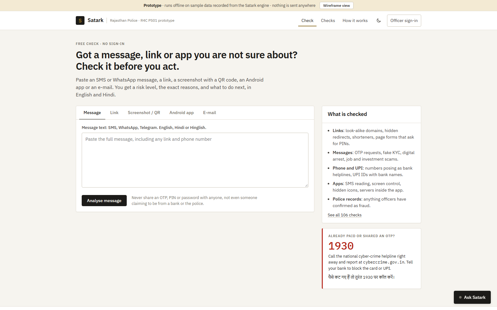
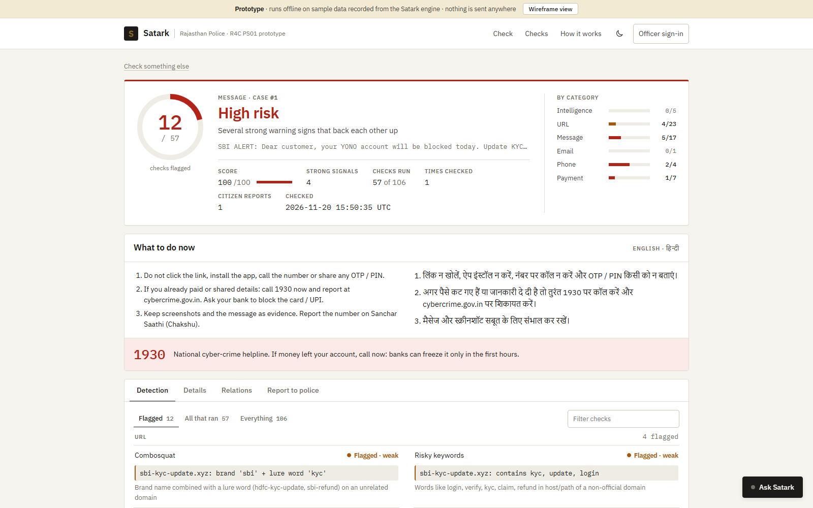
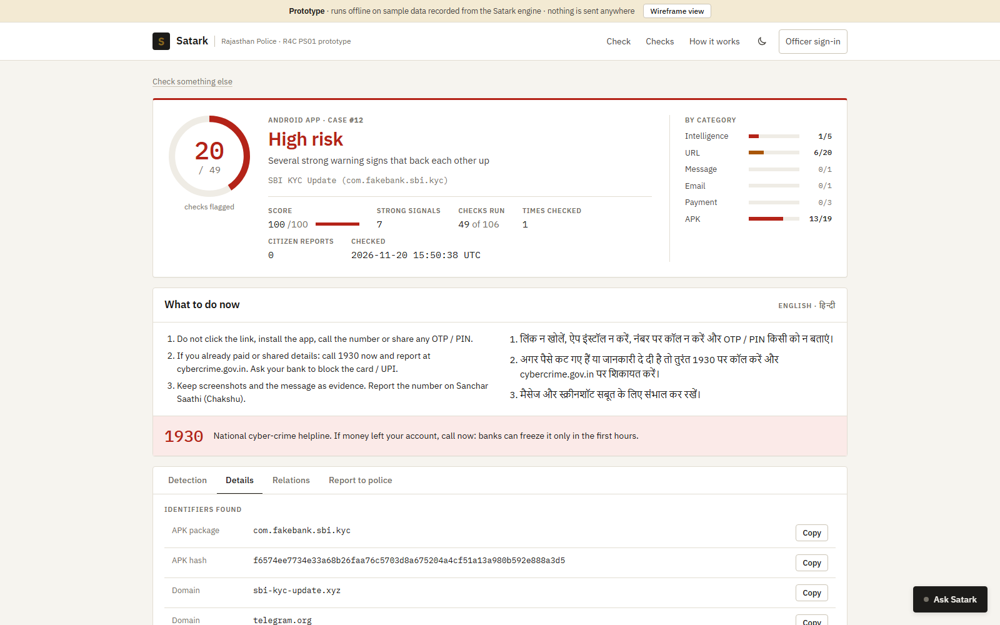
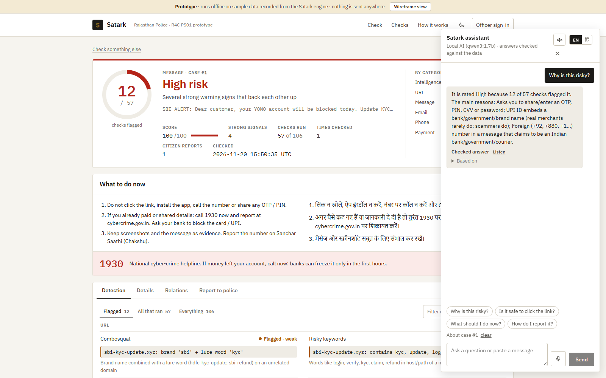
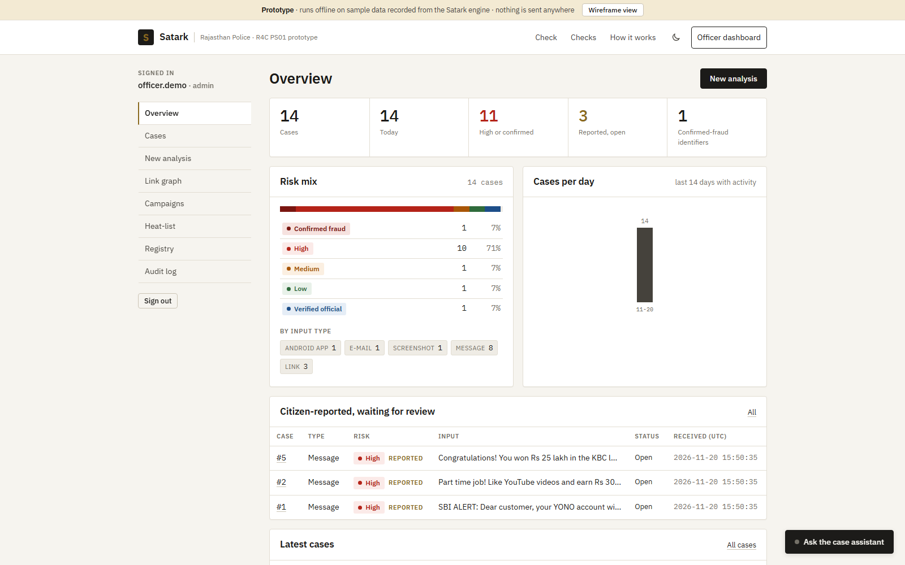
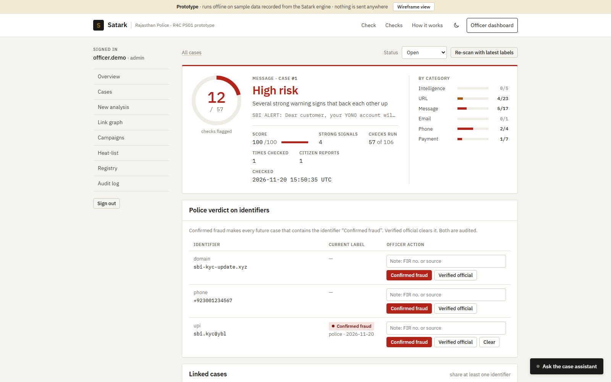
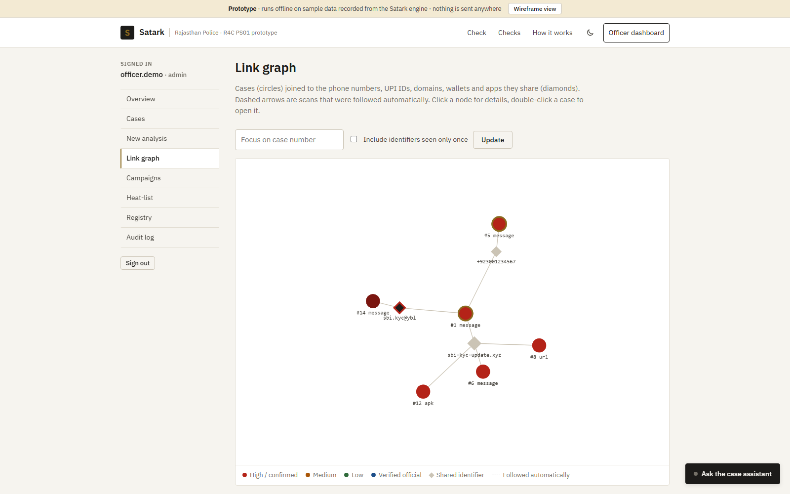
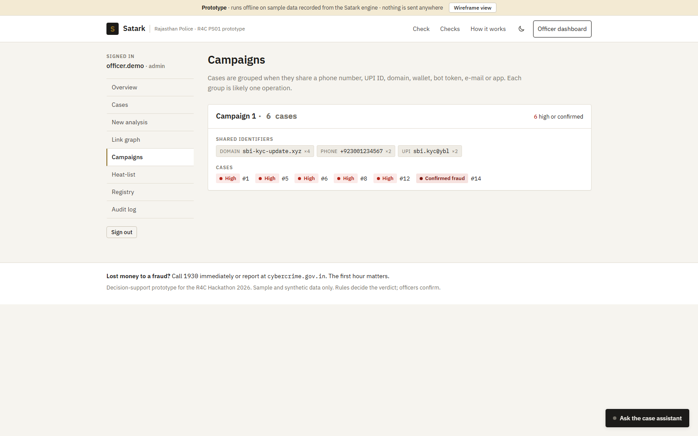

# Satark – Scam Intelligence Platform (PS01)

R4C Hackathon 2026, Rajasthan Police · PS01 Cyber Fraud / Phishing / Malicious Apps.

Satark checks suspicious **messages, links, screenshots / QR codes, Android apps and e-mails**, gives a risk level with
the exact reasons (106 rule-based checks), pulls out phone numbers, UPI IDs and domains, links cases that share them,
and gives officers a dashboard to confirm fraud. Channels: a Vue website, a Chrome extension with a snip tool and a
Telegram bot. A local AI assistant (Ollama) explains results in English and Hindi; the rules always decide.

## Screenshots
All screenshots use the built-in synthetic sample data (no real case data).

| Citizen check | High-risk result |
|---|---|
|  |  |
| **Android app (.apk) result** | **AI assistant (English / Hindi)** |
|  |  |
| **Officer overview** | **Officer case view** |
|  |  |
| **Link graph** | **Campaigns** |
|  |  |

More in [`screenshots/`](screenshots/).

## Features not built
[`New_to_add.txt`](New_to_add.txt) lists features that were planned for the next stage but were not built, because the
project was not selected for the hackathon's offline round:
* Automatic loan / phishing site finder and detector
* Scam call recording analyzer
* Matching against known scam templates

**Full documentation: [`manual/`](manual/00_READ_ME_FIRST.txt)** (files, settings, where to change what, API, scoring,
assistant, testing, security, troubleshooting, demo).

## Run
```
pip install -r requirements.txt
cd frontend && npm install && npm run build && cd ..
python app.py                      # http://127.0.0.1:5000
```
Officer login: `police`, password in `instance/initial_police_password.txt`. More users: `python manage.py adduser <name> officer`.
Tests: `python -m pytest tests -q`.

Optional: OCR (`pip install pytesseract` + Tesseract), AI (`ollama pull qwen3:1.7b`), Telegram bot
(`instance/telegram_token.txt`, then `python bots/telegram_bot.py`), extension (chrome://extensions → Load unpacked →
`extension/`). Offline venue: `set PS01_NETWORK=cache`. All settings: `manual/03_configuration.txt`.

## Layout
| Path | What |
|---|---|
| `app.py` | the server: website, downloads, security headers |
| `ui_api.py` / `api.py` | JSON API for the website (session + CSRF) / for the extension and bot (API key) |
| `core/` | engine: analysis, checks (`core/checks/<group>/<check>.py`, one file each), scoring, database, OCR, cache, assistant |
| `frontend/` | Vue 3 website (`npm run build` → `dist/`; `npm run build:proto` → offline prototype) |
| `extension/` | Chrome extension (Manifest V3) |
| `bots/telegram_bot.py` | Telegram bot |
| `tools/` | prototype, screenshots and wireframes for the submission |
| `tests/` | 135 automated tests |
| `instance/` | database, keys, passwords, tokens – private, never share |

## Known limits
* Check weights are hand-set; do not quote accuracy until measured on labelled R4C data (with the sample size).
* OCR reads English only on the development laptop (Hindi needs the Tesseract Hindi data file).
* WhatsApp bot not built. Flask's built-in server is for demos; use a production WSGI server beyond that.
